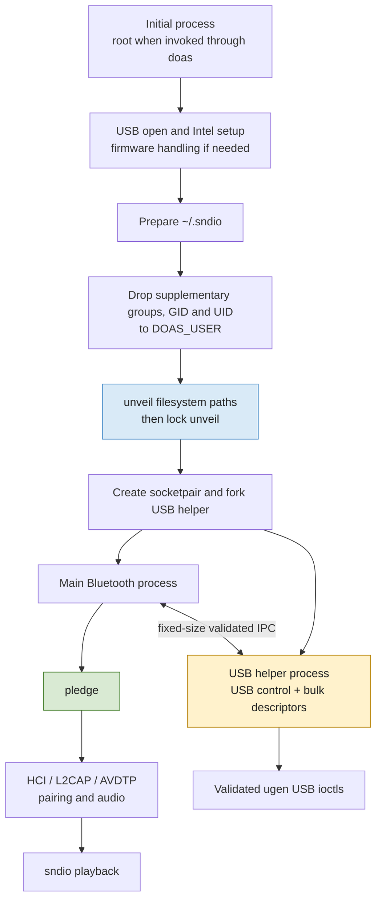

# btspk

`btspk` is a userland Bluetooth audio client for Intel Bluetooth
controllers. It uses the USB interface exposed by OpenBSD, implements
the required Bluetooth control and audio protocols in userland, and
sends audio through `sndio`.

This document describes the security mechanisms implemented by
`btspk`. It is not a security certification or a claim that every
code path has been audited.

## Security model

The design separates privileged device setup from the normal Bluetooth
protocol process:

1.  The initial process opens the USB device and performs Intel
    controller setup and firmware loading when required.
2.  For playback, it prepares the user's sndio directory.
3.  It drops root privileges to the user who invoked `doas`.
4.  In playback mode, it restricts filesystem visibility with
    `unveil()`.
5.  It starts a small USB helper process. The main process retains only
    the helper socket for privileged USB operations; the helper owns the
    USB control and bulk descriptors.
6.  The main process applies `pledge()` and performs HCI, Bluetooth
    protocol, pairing, and audio work.

The helper is a deliberately narrow exception to the sandbox: OpenBSD
has no `pledge` promise for the ugen USB ioctls used here. The helper is
therefore not pledged. Its accepted operations are constrained by a
fixed IPC protocol and validation before issuing ioctls.

## Process and sandbox diagram

The following diagram shows the intended privilege and syscall
boundaries in the playback path.



**Important:** the USB helper is not inside the main process's `pledge`
boundary. It is isolated by process separation and a restricted command
interface, not by `pledge()`.

## `unveil()` filesystem restrictions

The playback path calls `unveil()` after dropping privileges. It exposes
only the paths needed by the playback process:

  ------------------------------------------------------------------------
  Path                                   Permissions Purpose
  --------------------- ---------------------------- ---------------------
  `~/.sndio`                                   `rwc` sndio authentication
                                                     cookie and related
                                                     sndio state

  `~/.btspk`                                   `rwc` private Bluetooth
                                                     link-key file

  `/dev/tty`                                    `rw` numeric-comparison
                                                     confirmation prompt

  `/tmp/sndio`                                   `w` connect to the local
                                                     `sndiod` Unix-domain
                                                     socket
  ------------------------------------------------------------------------

After adding these paths, the program calls `unveil(NULL, NULL)` to lock
the rules. Other filesystem paths are no longer available to the pledged
playback process.

The key directory is created as `~/.btspk` with mode `0700` if it does
not already exist. The code checks that it is a directory owned by the
effective user and that group/other permission bits are clear.

The sndio directory is prepared before dropping privileges. The code
checks that it is a directory owned by the target user. It does not
require the directory itself to have mode `0700`; the key directory has
the stricter private-mode check.

`unveil()` is applied only to the playback path. The source does not
apply this filesystem sandbox to every command (for example, scan or
firmware management).

## `pledge()` syscall restrictions

The main process applies `pledge()` after USB setup and after starting
the USB helper.

### Playback mode

Initially, playback uses:

``` c
pledge("stdio rpath wpath cpath unix tty audio", NULL);
```

These promises support standard I/O, sndio's cookie and filesystem
handling, local Unix-domain socket communication, terminal confirmation,
and audio.

After `sio_open()` succeeds, the streaming path narrows the promises to:

``` c
pledge("stdio unix audio", NULL);
```

This removes filesystem and terminal access from the streaming phase
while retaining standard I/O, local IPC, and audio operations.

### Non-playback mode

Other commands use:

``` c
pledge("stdio unix", NULL);
```

The USB helper is not pledged because the required ugen ioctls are not
available through a pledge promise in this design.

## USB helper boundary

The helper is started with a Unix-domain `socketpair()` and `fork()`.
The parent closes its USB control descriptor after the helper starts.
Requests are sent as fixed-size IPC messages and receive fixed-size
replies.

The helper accepts only two operation classes:

-   **USB control requests:** HCI command requests are checked for the
    expected request type, request code, length, embedded HCI parameter
    length, opcode, and opcode-specific parameter length. Endpoint-halt
    clearing is limited to the known event and ACL endpoints.
-   **Bulk endpoint ioctls:** only the supported timeout and
    short-transfer controls are accepted, with bounded values. The
    optional bulk read-ahead ioctl is similarly limited when available
    at compile time.

The HCI command whitelist is explicit. It includes the commands needed
for inquiry, connection management, link-key replies/deletion,
authentication, encryption, Secure Simple Pairing, Secure Connections,
event masks, and buffer setup.

The helper does not parse Bluetooth packets or implement the Bluetooth
protocol. Those operations remain in the main process.

The IPC messages and replies are cleared with `explicit_bzero()` after
use. The helper closes its USB descriptors and exits when its IPC
channel closes.

## Privilege dropping

When started with effective UID 0, the program requires `DOAS_USER` to
identify the invoking user. It resolves that account, initializes the
user's supplementary groups, then sets real/effective/saved GID and UID
to the target user. It fails closed if the account cannot be resolved or
the privilege drop fails.

The program also sets `HOME` to the target user's home directory.

The USB device must be opened and any required privileged controller
setup must happen before this drop. Normal HCI operation and playback
then run as the invoking user.

## Bluetooth pairing and link security

The normal pairing policy is designed to require MITM-protected pairing:

-   Secure Simple Pairing is enabled on the controller.
-   Secure Connections Host Support is enabled. Failure to enable either
    mode aborts initialization.
-   The local I/O capability is `DisplayYesNo`, with the MITM bit
    requested.
-   Numeric Comparison is accepted only when the remote I/O capability
    is compatible (`DisplayYesNo` or `KeyboardDisplay`).
-   The user must confirm the displayed six-digit number on the local
    terminal. A rejected or unavailable confirmation aborts pairing.
-   Passkey-entry requests are rejected because this implementation does
    not provide a passkey-entry workflow. Passkey notification is also
    rejected.
-   Newly received link keys are saved by default only when the key type
    is authenticated and the remote I/O capability supports Numeric
    Comparison.
-   If a received key does not meet the policy, the program asks the
    controller to delete the stored key and removes the corresponding
    local entry.
-   After authentication and encryption, the program reads the
    negotiated encryption key size and refuses a key shorter than 128
    bits.

### Explicitly weaker options

Two options weaken the normal policy and should be treated as diagnostic
or compatibility switches, not as secure defaults:

-   `-J` explicitly permits Just Works pairing. Just Works does not
    provide MITM protection. The program prints a warning, requests no
    MITM, and may save unauthenticated combination keys.
-   `-S` skips authentication and encryption. It bypasses the normal
    link security checks entirely.

`-J` and `-S` are mutually exclusive. A run using either option must not
be described as having the default authenticated pairing protection.

## Link-key storage

Link keys are stored in `~/.btspk/keys`, not in a world-readable
location.

The source applies these protections:

-   The containing directory is created with mode `0700` and checked for
    ownership and group/other access.
-   The key file is opened with `O_NOFOLLOW` and `O_NONBLOCK`.
-   The opened object must be a regular file, owned by the effective
    user, with no group/other permission bits and a bounded size.
-   Only authenticated combination keys are loaded by default.
    Unauthenticated key types are considered only when `-J` was
    explicitly selected.
-   Updates are written to a `mkstemp()` file, flushed, synchronized
    with `fsync()`, and atomically renamed over the old file.
-   The process sets `umask(077)`.
-   Temporary key buffers and selected protocol/IPC buffers are cleared
    with `explicit_bzero()`.

The program does not intentionally persist link keys in the controller's
stored-key database. When an unacceptable key is reported by the
controller, the code issues a delete-stored-key command.

## Firmware input

Firmware is opened with `O_NOFOLLOW`. The opened object must be a
regular file and its size must not exceed `INTEL_FW_MAX_SIZE`. The
firmware is read before the normal playback sandbox is installed, as
part of privileged controller setup.

The controller's Intel secure-download mechanism is used for firmware
acceptance. This source does not establish a host-side firmware hash
allowlist or independently verify a firmware signature before sending
it. Do not infer those protections from the use of the controller's
secure-download command.

## Logging and sensitive data

The verbose trace routine emits only HCI command and event records. It
does not emit the raw ACL, AVDTP, bulk, audio, or firmware payload
traces. Numeric confirmation and passkey-notification event data is
truncated before logging. The code also explicitly clears a number of
link-key, event, command, audio, and IPC buffers.

Verbose logging should still be reviewed before collecting logs for
public bug reports; logs can contain Bluetooth addresses and other
device metadata.

## Limits and review notes

These controls reduce exposure, but they do not prove the program is
free of memory-safety, protocol, logic, kernel, firmware, or hardware
vulnerabilities. The USB helper is not pledged, and its safety depends
on the correctness of its IPC validation and ioctl allowlist. The
firmware trust decision ultimately depends on the controller's
secure-download implementation and the firmware source.

**Source review item:** inspect `read_full()` before release. Ensure
that each loop iteration performs only one `read()` call, handles
`EINTR` and end-of-file correctly, and advances the buffer only by the
number of bytes actually read. This is important because the function
handles fixed-size IPC records.

The program has not been certified by an external security auditor.
Native OpenBSD compilation, runtime testing, controller compatibility
testing, and pairing tests should be performed on the target system
before release.

## Command-line options

`btspk` accepts options before the command. The available commands are
`info`, `reset`, `scan`, `upload`, and `play`.

### Usage

```sh
btspk [-EJSqv] [-f firmware.sfi] [-u unit] \
    info | reset | scan | upload

btspk [-JSqv] [-F ms] [-b ms] [-d device] [-n frames] \
    [-u unit] play bdaddr
```

`bdaddr` is the Bluetooth address of the A2DP audio sink, in the form
`aa:bb:cc:dd:ee:ff`.

### Options

| Option | Meaning |
| --- | --- |
| `-E` | Use the ECDSA firmware header format instead of the default RSA format when uploading Intel firmware. |
| `-f firmware.sfi` | Path to the Intel `.sfi` firmware image. Required by the standalone `upload` command and when the controller needs firmware. |
| `-u unit` | Select the OpenBSD `ugen` unit number for the Bluetooth USB device. Default: `0`. |
| `-J` | Explicitly allow Just Works pairing. This has no MITM protection; see [Pairing and link security](#bluetooth-pairing-and-link-security). |
| `-S` | Skip Bluetooth authentication and encryption. Diagnostic/compatibility mode only; it bypasses the normal link-security checks. |
| `-q` | Quiet mode: suppress informational messages and non-fatal warnings. Fatal errors are still reported. |
| `-v` | Enable verbose diagnostics. Trace output is limited to HCI command/event information; it does not dump raw audio or bulk payloads. |
| `-F ms` | Set the controller connection flush timeout in milliseconds. Range: `0`–`1000`; `0` disables the timeout. Default: `100` ms. |
| `-b ms` | Set the sndio capture buffer duration. Range: `10`–`60000` ms. Default: `30` ms. |
| `-d device` | Select the sndio device. The playback path accepts `snd/` devices; default: `snd/mon`. |
| `-n frames` | Number of SBC frames placed in each media packet. Range: `1`–`15`; default: `2`. |

`-J` and `-S` cannot be used together. `-F`, `-b`, `-d`, and `-n` are
playback settings. `-E` and `-f` are firmware settings.

### Commands

| Command | Description |
| --- | --- |
| `info` | Display Intel controller/firmware information. |
| `reset` | Reset the Intel Bluetooth controller. |
| `scan` | Perform Bluetooth device inquiry and report discovered devices. |
| `upload` | Upload the specified Intel firmware image to the controller. Use `-f`; `-E` selects the ECDSA header format. |
| `play bdaddr` | Connect to the specified Bluetooth A2DP sink, negotiate SBC audio, and stream audio through sndio. |

### Examples

```sh
# Show controller and firmware information
doas btspk info

# Scan for nearby Bluetooth devices
doas btspk scan

# Upload an Intel firmware image
doas btspk -f ibt-XX.sfi upload

# Play to an A2DP sink using the default sndio device
doas btspk play 04:fe:a1:8c:3a:fb

# Select the sndio device and use four SBC frames per packet
doas btspk -d snd/0 -n 4 play 04:fe:a1:8c:3a:fb

# Permit Just Works pairing for a device that cannot use Numeric Comparison
doas btspk -J play 04:fe:a1:8c:3a:fb
```

The last example deliberately weakens pairing security. Just Works does not
protect against man-in-the-middle attacks.

## Security summary

-   Privileged USB setup is separated from the normal unprivileged
    protocol process.
-   The main playback process drops privileges, uses `unveil()`, and
    narrows `pledge()` promises.
-   USB operations are brokered through a fixed, validated IPC
    interface.
-   Pairing defaults to Secure Simple Pairing / Secure Connections with
    Numeric Comparison and MITM protection.
-   Negotiated encryption key size is checked for a 128-bit minimum.
-   Link keys are stored in a private, owner-checked file and updated
    atomically.
-   Firmware files are opened without following symlinks and
    size-limited.
-   Verbose tracing avoids dumping raw audio and protocol payloads.

The `-J` and `-S` options deliberately weaken Bluetooth link security
and must be considered when interpreting the protection provided by a
particular run.
